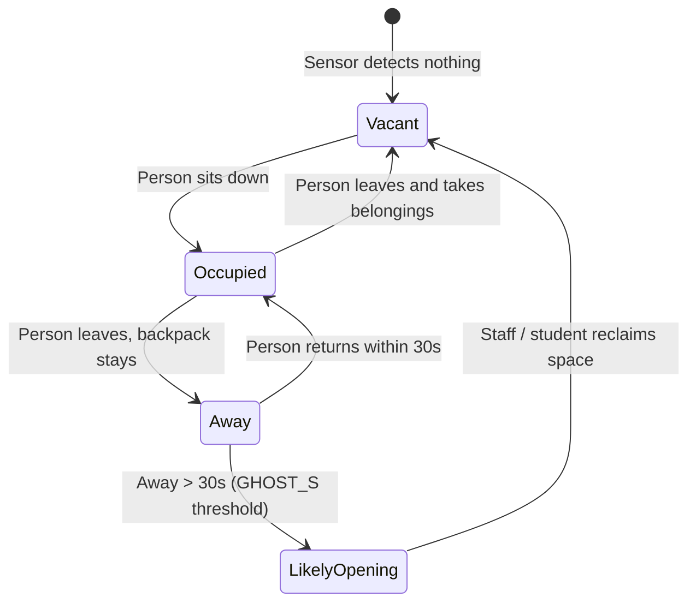

# Synapse (Ghost Seats)

> **Real-time IoT library desk occupancy sensing that eliminates ghost seats, paired with AI-driven study partner matching.**
> *Built for HackTX 2026 at The University of Texas at Austin.*

---

## 📸 Overview & Live Application

| Campus Availability & Login | Live Floorplan & "Best Seat" | Meta AI Study Host Matching |
|:---:|:---:|:---:|
|  |  |  |
| **Real-time library density** across PCL, Welch, and GDC | **Dynamic desk occupancy**: Blue = Vacant, Green = Occupied | **Course matching & icebreakers** powered by Meta AI |

---

## 💡 The Problem: "Ghost Seats" & Campus Isolation

Walking into campus study spaces like the **PCL**, **Welch Hall**, or the **GDC** during midterms and finals can feel impossible. But the most frustrating part isn't a truly full library—it is **"ghost seats"**:
1. **False Reservations:** Desks hogged for hours by an unattended backpack, laptop, or jacket while students wander the halls looking for an empty chair.
2. **Cold-Start Social Friction:** Students studying difficult subjects alone often want a study partner, but approaching a stranger is intimidating (*"Is this seat saved? Are they studying what I'm studying? What do I say?"*).

**Synapse** solves both by connecting physical desk IoT hardware with a live digital seat map and generative AI.

---

## 🛠️ Hardware Setup & Campus Table Deployment

### Proposed Campus Library Desk Installation

Below is the production deployment architecture for standard university study carrels and tables:

<p align="center">
  
</p>

### Physical Implementation Details

```
+---------------------------------------------------------------------------------+
|                                CAMPUS STUDY DESK                                |
|                                                                                 |
|   [ Desk Surface ]                                                              |
|   +-------------------------------------------------------------------------+   |
|   |  Seat 1                                            Seat 2               |   |
|   |  [QR Sticker]   [LED Indicator Bar]    [LED Indicator Bar] [QR Sticker] |   |
|   |   (Check-in)     (Blue/Green Glow)      (Blue/Green Glow)   (Check-in)  |   |
|   |                                                                         |   |
|   |  [Object Sensor]                                   [Object Sensor]      |   |
|   |  (Optical/IR)                                      (Optical/IR)         |   |
|   +-------------------------------------------------------------------------+   |
|                                                                                 |
|   [ Under-Desk Housing ]                                                        |
|   +--------------------------+               +--------------------------+       |
|   | [Human Presence Sensor]  |               | [Human Presence Sensor]  |       |
|   | (Aimed at Chair Cushion) |               | (Aimed at Chair Cushion) |       |
|   +------------+-------------+               +------------+-------------+       |
|                |                                          |                     |
|                +--------------------+---------------------+                     |
|                                     |                                           |
|                           [Under-Desk IoT Hub]                                  |
|                       (Arduino / ESP32 Controller)                              |
|                                     |                                           |
|                       [Telemetry to Bridge / Cloud]                             |
+-------------------------------------+-------------------------------------------+
```

### Prototype Hardware Implementation

Our functioning hackathon prototype uses an **Arduino board with a Grove sensor shield**, digital optical IR sensors, and dual-color LED indicators:

<p align="center">
  
</p>

* **IR Human Seating Sensor:** Mounted beneath the desk edge, focused on the chair seat to detect actual student presence.
* **IR Object Sensor:** Aimed at the desk surface to detect left-behind laptops, notebooks, or bags.
* **Dual-Color Status LED:**
  * 🔵 **Blue (`#3b82f6`):** Seat is **Vacant** and ready for use.
  * 🟢 **Light Green (`#22c55e`):** Seat is **Occupied**.
  * ⚡ **Pulsing Blue Beacon:** Activated when a matched study partner is walking over, guiding them straight to your table.
* **Local Serial Pipeline:** Arduino streams JSON sensor frames over USB at 115200 baud to `arduino_bridge.py`, which authenticates against the backend via `X-Node-Key`.

---

## 🧠 The "Ghost Seat" State Engine

How does Synapse distinguish a quick bathroom break from an abandoned seat hog?



### State Resolution Rules
* **Debounce Window (`DEBOUNCE_S = 1s`):** Filters out physical sensor noise, jitter, and students fidgeting in their chairs.
* **Ghost Timer (`GHOST_S = 30s` in demo):** If an object remains on the desk but no human is detected for $\ge 30\text{ seconds}$, the seat transitions from `Occupied` to `Likely Opening` on the live map.
* **Privacy by Design:** Away durations are calculated entirely in memory on the server and never broadcasted. Nobody can track another student's exact absence timestamps.

---

## 🤖 Meta AI Collaboration & "Host Mode"

When students sit at an open table, they don't have to study in isolation:

1. **Host Mode Activation:** A student taps their seat on the interactive map (or scans the desk QR code) and enters what they are studying (e.g., *"orgo 1 midterm"* or *"CS 429 assembly"*).
2. **Catalog Normalization:** Meta’s **Muse Spark (`muse-spark-1.3`)** model normalizes free-form text into official university course catalog codes (`CH 320M`, `CS 429`) and extracts semantic study concepts.
3. **Compatibility Ranking:** Arriving students browse active hosts by course. The AI scores prospective study partners (0–100) based on shared subjects and syllabus topics.
4. **Contextual Icebreaker Generation:** Once a match is confirmed, the model generates an approachable, course-specific conversation starter under 140 characters:
   > *"Which chair flip is tripping you up on practice problem 3?"*
5. **Physical Beacon:** The host's desk LED pulses blue, acting as a visual guide in crowded libraries.

---

## 🏗️ System Architecture

```
[ Arduino Sensors & LEDs ]
           │ (Serial @ 115200 baud)
           ▼
[ Python Serial Bridge (arduino_bridge.py) ]
           │ (Authenticated HTTP POST /api/readings)
           ▼
[ FastAPI Backend Engine ] ◄────► [ TimescaleDB / Tiger Data ]
      │             │             (Time-series occupancy metrics)
      │             ▼
      │     [ Meta AI Model API ]
      │     (Muse Spark: Normalization & Icebreakers)
      ▼
[ React + Vite Frontend PWA ]
 (Interactive SVG maps, live seat polling, responsive cards)
```

---

## 💻 Tech Stack

| Domain | Technologies |
|---|---|
| **Hardware & IoT** | Arduino (C++), Optical IR Proximity Sensors, Dual-Color LEDs (Blue/Green), Grove Shield |
| **Bridge Daemon** | Python 3.12, PySerial, HTTPX |
| **Backend API** | FastAPI, Uvicorn, Pydantic v2, ItsDangerous, PyWebPush, Segno (QR codes) |
| **Database & Metrics** | TimescaleDB / Tiger Data (hyper-tables for occupancy time-series), Psycopg 3 |
| **AI Track (Meta)** | Meta Muse Spark (`muse-spark-1.3`) via Meta Model API |
| **Frontend & UI** | React 18, Vite, Vanilla CSS design system, MapLibre GL, Lucide Icons, PWA Manifest |
| **Code Quality** | Pytest (150+ tests), Ruff linter, Mypy strict typing |

---

## 🚀 Getting Started

### Prerequisites
* Python 3.12+
* Node.js 18+ and npm
* (Optional) Arduino Uno/Nano with firmware uploaded

### 1. Backend Setup
```bash
cd backend
# Create environment file
cp .env.example .env

# Install dependencies and start server (runs in standalone in-memory mode by default)
pip install -r pyproject.toml # or uv sync
python -m uvicorn app.main:build --factory --port 8000
```
Backend runs at `http://localhost:8000`. API docs available at `http://localhost:8000/docs`.

### 2. Frontend Setup
```bash
# In the repository root
npm install
npm run dev
```
Open `http://localhost:5173` in your browser.

### 3. Connect Physical Hardware
```bash
# Plug in Arduino via USB, then run the serial bridge daemon:
python backend/scripts/arduino_bridge.py
```

---

## 🧪 Test Suite

We maintain a rigorous automated test suite covering state transitions, seat debouncing, AI fallback logic, and session security:

```bash
# Run backend test suite
cd backend && pytest tests/unit tests/services
```
* **150+ Unit & Service Tests** pass with 100% reliability in standalone mode.
* **Fallback Guarantee:** The system uses a `GuardedAI` wrapper so that if the external AI service times out, the app gracefully falls back to deterministic course matching without disrupting users.

---

## 👥 The Team
Built with ❤️ at **HackTX 2026** by:
* **Sourish**
* **Siddhartha (Sid)**
* **Manideep (Mani)**
* **Dina**
