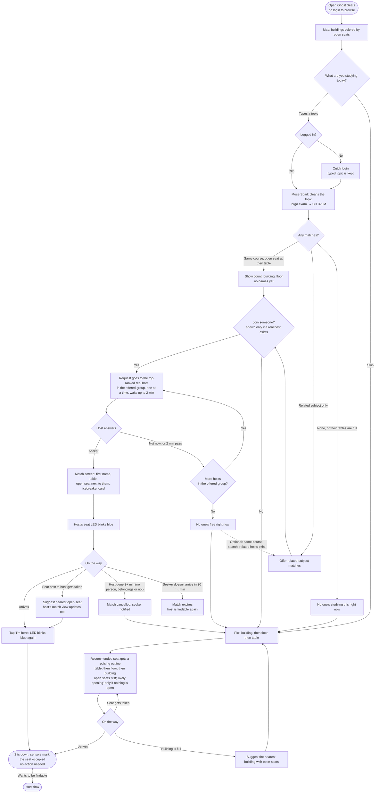
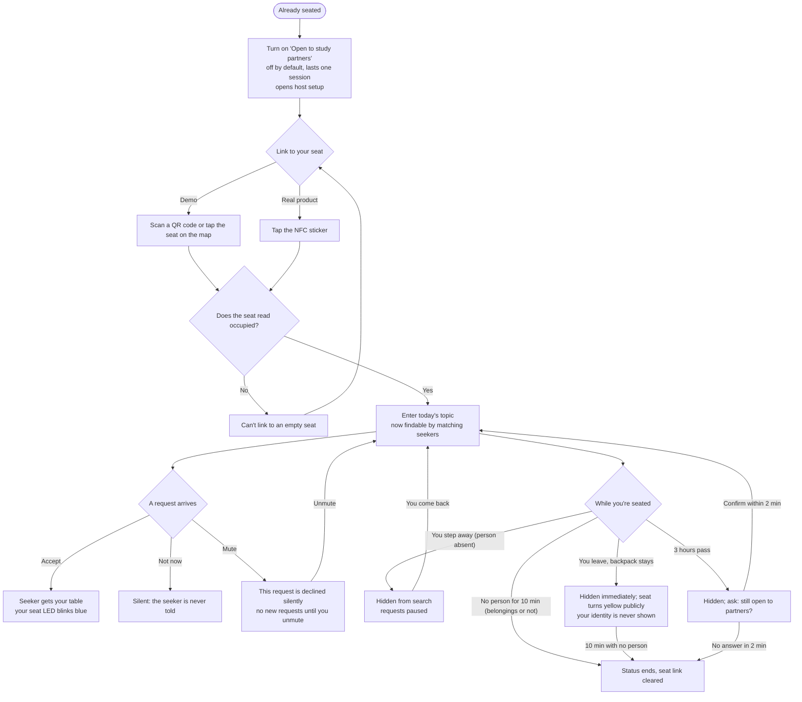

# Ghost Seats — User flows (v1.1)

**Authoritative for user-facing behavior**, alongside `REQUIREMENTS.md`.
Transcribed from the team's flowcharts. Anything neither this file nor
REQUIREMENTS settles is an open question in `PLAN.md`; it is not decided by
assumption.

**Revised in v1.1.** The team found these errors in the original flowcharts
and corrected them. Decision numbers refer to the `PLAN.md` decision log.

| Original wording | v1.1 | Decision |
|---|---|---|
| "Host leaves, seat empty 2+ min" / "Seat empty for 10 min" | No person for 2 / 10 min, whether or not belongings remain | D18 |
| "You leave, backpack stays → stay hidden" | Hidden immediately; the session still ends after 10 min with no person | D18 |
| "Mute → no more requests this session" | Declines this request; no new requests until unmuted | D20 |
| "3 hours pass → ask: still open?" | Hidden while asking; 2 min to confirm, otherwise the session ends | D24 |
| "Recommended seat gets a pulsing outline" | Widens from table to floor to building | D21 |
| "Join someone?" | Shown only when the offered group has a real host | D19, D22 |
| "Turn on 'Open to study partners'" | Opens host setup; the session is created at link | D17 |
| — | Optional "Try related material?" after a same-course search runs out | D19 |

## 1. Seeker / visitor flow

| Flow step | Requirement | Endpoint / note |
|---|---|---|
| Open, no login; map colored by open seats | FR-8, FR-14 | `GET /api/buildings` |
| "What are you studying today?" / Skip | FR-17 | Client prompt |
| Logged in? → Quick login, topic kept | FR-15, 16, 18 | `GET /api/demo-users`, `POST /api/login` |
| Muse Spark cleans the topic | FR-18, 19; §9 | Inside `POST /api/search` |
| Any matches? — same course / related only / none | FR-24, 29 (D19) | `POST /api/search` → `offered_group`, `same_course`, `related` |
| None, or their tables are full | FR-24 | Both groups empty → "No one's studying this right now" |
| Join shown only if a real host exists | FR-29 (D19, D22) | `has_real_hosts`; join otherwise returns `no_real_hosts` |
| Request to the top-ranked real host, up to 2 min | FR-30..32 (D15, D22); `REQUEST_TIMEOUT_S` | `POST /api/search/:id/join`, poll `GET /api/search/:id` |
| Not now, or 2 min pass → more hosts in the offered group? | FR-32, 33, 36 (D19) | The cascade never crosses groups |
| No one's free right now | FR-33, FR-52 | Search `exhausted`; push to the seeker |
| Optional: try related material | FR-54 (D19) | `POST /api/search {topic_raw, group: "related"}` |
| Match screen | FR-37, 38, 52 | `GET /api/matches/:id`; push "accepted" to the seeker |
| Host's seat LED blinks blue | FR-7, 37; `BLINK_S` | `blue_blink` in the `POST /api/readings` response |
| Arrives → "I'm here", blinks again | FR-40 | `POST /api/matches/:id/arrived` |
| Seat next to host taken → nearest open seat | FR-39 (D25) | `alt_seat_id` in both match views; no push |
| Host gone 2+ min → cancelled, seeker notified | FR-41 (D18), FR-52; `HOST_LEAVE_CANCEL_S` | Evaluated on ingest (NFR-2); push to both |
| Seeker doesn't arrive in 20 min → expires | FR-42, 52; `MATCH_TIMEOUT_S` | Scheduler tick (NFR-2); push to both |
| Pick building, then floor, then table | FR-9 | `GET /api/buildings/:id` |
| Recommended seat, widening | FR-11, 12 (D21) | `GET /api/recommend?building_id&floor&table_id` → `level` |
| Seat gets taken → new recommendation | FR-10, 11 | Client re-polls `GET /api/recommend` |
| Building is full → nearest building | FR-11 | `{full: true, nearest_building_id}` (uses `buildings.lat/lng`) |
| Sits down: sensors mark the seat occupied | FR-1..3 | `POST /api/readings` |
| Wants to be findable → Host flow | FR-50 (D23) | Allowed once no search or match is active |

## 2. Host flow

| Flow step | Requirement | Endpoint / note |
|---|---|---|
| Turn on "Open to study partners"; opens host setup | FR-20 (D17) | Client only; no request sent |
| Link, demo: scan a QR code or tap the seat on the map | FR-21 (D17) | Route `/seat/{seat_id}` → `POST /api/host/link` creates the session; QR codes encode `<origin>/seat/<seat_id>` |
| Link, real product: tap the NFC sticker | §11 lists NFC tags as out of scope | Not built |
| Does the seat read occupied? No → can't link | FR-22 | Error `seat_not_occupied`; `already_searching` if FR-50 applies |
| Enter today's topic → findable | FR-23, 24 | `POST /api/host/topic` |
| Request arrives → Accept | FR-37, 51, 52 | Push "request received"; `POST /api/requests/:id/accept` |
| Not now → silent | FR-36 | `POST /api/requests/:id/decline` |
| Mute → declined, no new requests; unmute | FR-28 (D20) | `POST /api/requests/:id/decline {mute: true}`; `POST /api/host/mute {muted: false}` |
| No person for 10 min → status ends | FR-26 (D18); `HOST_END_S` | Evaluated on ingest (NFR-2); push "session ended" |
| Step away → hidden, requests paused; come back → findable | FR-24, 25 (D18) | `/api/me` → `hidden_reason: away` |
| Leave, backpack stays → hidden, yellow publicly, identity never shown | FR-4, 6, 25, 26, 43 (D18) | Same timers as stepping away |
| 3 hours pass → hidden; confirm within 2 min | FR-27 (D24); `SESSION_MAX_S`, `CONFIRM_GRACE_S` | Push "confirm needed"; `POST /api/host/confirm`; scheduler ends it otherwise |
